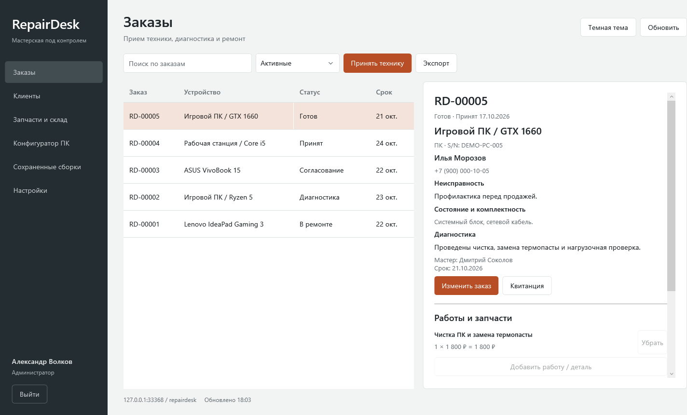
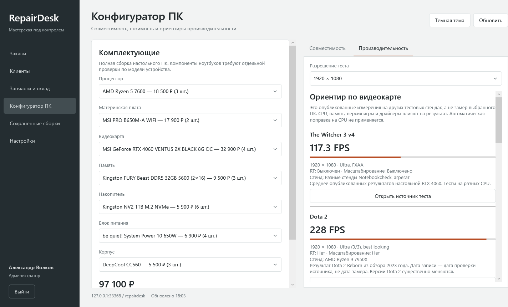

# RepairDesk

Приложение для Windows для учета ремонта ПК и ноутбуков. Главный экран — журнал заказов с карточкой устройства. Встроенный конфигуратор проверяет основные параметры совместимости настольного ПК и показывает опубликованные результаты игровых тестов из локального каталога.





## Запуск

Готовый автономный комплект: распаковать архив **целиком** и открыть `RepairDesk.exe`. Он включает .NET и переносимую MariaDB. Docker, Visual Studio, подключение к интернету и установка службы для этого варианта не нужны.

Учебные учетные записи:

| Логин | Роль | Начальный пароль |
|---|---|---|
| admin | Администратор | RepairDesk2026! |
| reception | Приемщик | RepairDesk2026! |
| master | Мастер | RepairDesk2026! |

После первого входа пароль можно сменить в настройках. Все клиенты, телефоны, цены и остатки в стартовой базе демонстрационные.

Подробности: [запуск на учебном ПК](docs/QUICKSTART.md), [архитектура](docs/ARCHITECTURE.md), [демонстрация](docs/DEMO.md), [источники игровых тестов](docs/BENCHMARKS.md).

## Возможности

- Прием техники, состояние и комплектность, серийный номер, назначение мастера и срок.
- Диагностика и последовательные статусы ремонта; закрытие после полной оплаты.
- Работы, запчасти, частичные оплаты и возвраты. Цена позиции фиксируется в заказе.
- Склад: поступление и списание, минимальный остаток, история движений, добавление комплектующих и редактирование характеристик.
- Проверки сокета CPU, типа и объема RAM, форм-фактора платы, длины GPU, запаса мощности и разъема питания GPU. BIOS, QVL, кулер и физические зазоры дополнительно проверяются по документации.
- Сохранение предложения клиенту и создание заказа на сборку с атомарным выделением семи комплектующих со склада.
- Локальные игровые тесты для 1080p, 1440p и 4K с источниками, настройками и ограничениями. Покрытие зависит от игры и GPU; отсутствующие результаты не подменяются выдуманными оценками.
- Квитанция с предпросмотром и печатью, экспорт заказов в `.xlsx`, согласованная резервная копия SQL.
- Роли администратора, приемщика и мастера, история заказов, светлая и темная темы.

## Исходники и сборка

Требуется Windows 10/11 x64 и .NET SDK с поддержкой .NET 8 (или Visual Studio 2022 с разработкой классических приложений .NET).

```powershell
dotnet build RepairDesk.sln -c Release
dotnet run --project tests/RepairDesk.Tests -c Release
dotnet run --project src/RepairDesk.Desktop -c Release
```

Для запуска из исходников используйте MySQL 8.0.13+ / MariaDB 10.6+ и SQL-скрипты из `database` по порядку: `schema.sql`, `demo.sql`, `benchmarks.sql`. Можно импортировать их через phpMyAdmin. Миграции и автоматические изменения существующей схемы не используются. В окне входа есть настройка подключения и создание **новой пустой** учебной базы.

Приложение напрямую подключается к локальной БД через MySqlConnector. Сервер REST API не требуется. Автономный комплект запускает собственный MariaDB на loopback-адресе; обычная сборка может подключаться к Open Server.

## Проверки

Проверки бизнес-правил работают без базы. Интеграционные сценарии должны запускаться только на отдельной учебной базе: они добавляют заказы и клиента, проверяют оплаты, откаты транзакций, ограничения ролей и восстановление копии.

```powershell
$env:REPAIRDESK_TEST_PORT = '33367'
$env:REPAIRDESK_TEST_PASSWORD = '<пароль root тестового сервера>'
$env:REPAIRDESK_TEST_OUTPUT = '<каталог промежуточных результатов>'
dotnet run --project tests/RepairDesk.Tests -c Release -- --integration --initialize
dotnet run --project tests/RepairDesk.UiTests -c Release
```

`--initialize` разрешен только для пустой базы `repairdesk`. Проверка восстановления создает базу `repairdesk_qa_restore`; при повторе ей также нужна пустая схема. Проверки интерфейса отрисовывают страницы WPF, обе темы, минимальный размер окна и экспорт Excel.

## Подготовка автономного комплекта

Скачайте официальный Windows ZIP MariaDB 11.8.9 и проверьте SHA-256 по опубликованной сумме. Затем:

```powershell
.\scripts\publish.ps1 -MariaDbDirectory 'C:\packages\mariadb-11.8.9-winx64'
```

Скрипт создает соседнюю папку `RepairDesk-Portable`. Не добавляйте двоичные сборки, персональные настройки, резервные копии и рабочую базу в публичный Git. Лицензии зависимостей и ссылка на исходники MariaDB: [THIRD-PARTY.md](docs/THIRD-PARTY.md).
